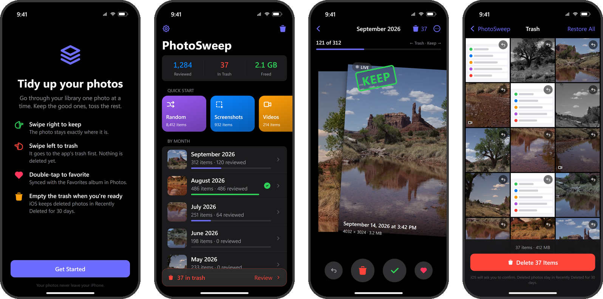
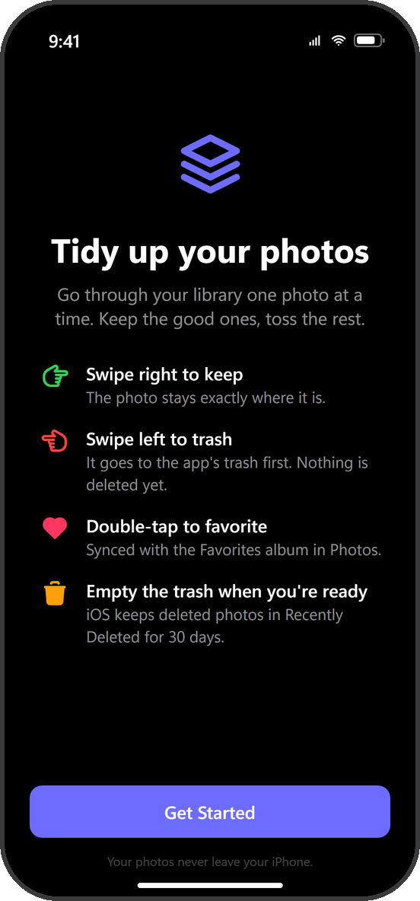
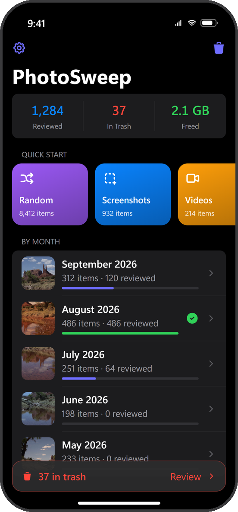
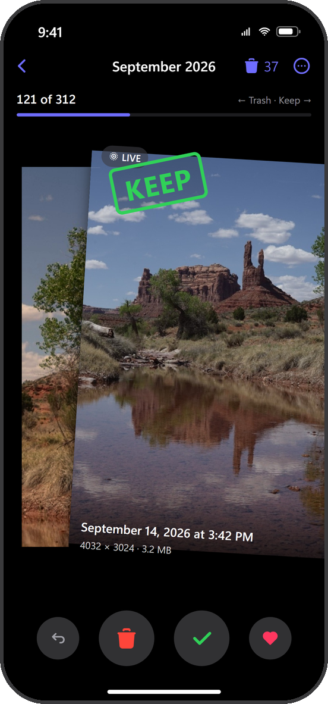
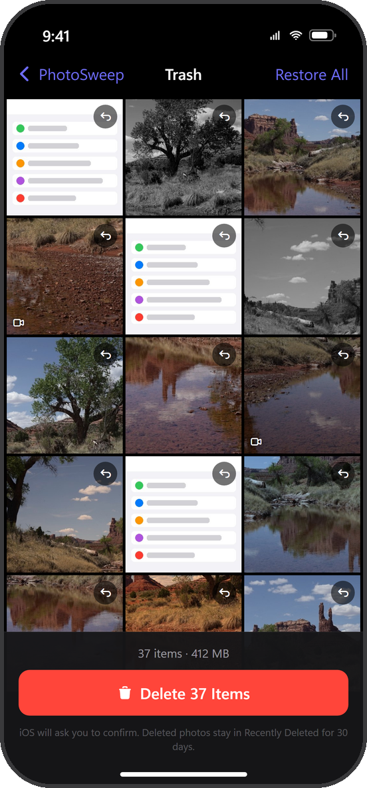
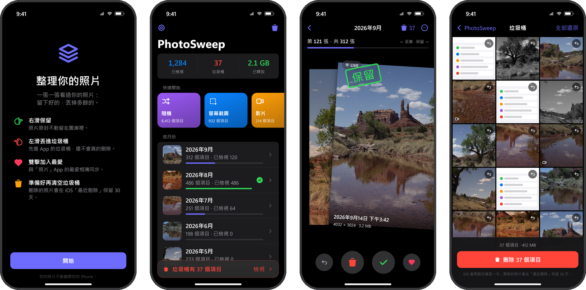

<p align="center">
  
</p>

<h1 align="center">PhotoSweep</h1>

<p align="center">
  <b>Swipe through your iPhone photo library one picture at a time — keep the good ones, trash the rest, free up space.</b><br>
  <b>Picnic 風格的 iPhone 照片整理 App</b>——右滑保留、左滑丟垃圾桶、雙擊加最愛，清空垃圾桶前不會真的刪除任何照片。
</p>

<p align="center">
  
</p>

<p align="center"><sub>Screens are UI mockups drawn from the app's actual layout and strings, using a CC0 sample photo from raw.pixls.us. Device screenshots will replace them.<br>
畫面為依照 App 實際版面與文字繪製的示意圖，照片為 raw.pixls.us 的 CC0 範例；之後會換成實機截圖。</sub></p>

## Features · 功能

- **Swipe to decide** — right to keep, left to trash, or use the buttons under the card. Undo works even on the last photo.
- **Double-tap to favorite** — synced with the Favorites album in Apple Photos.
- **Tap to inspect** — full-screen view with pinch-zoom and pull-down-to-close; videos play inline.
- **Browse by month** — every month is a deck with its own progress bar, remembered between launches.
- **Quick modes** — Random, Screenshots, Videos, Favorites, All Photos.
- **Trash with a safety net** — restore one or all, see the total size, empty it in one tap. iOS asks you to confirm and keeps deleted photos in *Recently Deleted* for 30 days.
- **Stats** — photos reviewed, items in trash, space freed.
- **Limited access and iCloud** — works with "Selected Photos Only"; iCloud originals load on demand.
- **100% on-device** — no network, no account, no analytics.
- **Three languages** — Traditional Chinese, Simplified Chinese, English, following the system language.

## How to use

| | |
|:---:|:---:|
|  |  |
| **1. Allow photo access** | **2. Pick what to review** |
|  |  |
| **3. Swipe** | **4. Empty the trash** |

1. **Allow photo access.** Tap *Get Started* and choose *Allow Full Access*. With *Limited Access* you only see the photos you picked; tap *Select More* on the home screen to add more.
2. **Pick what to review.** The home screen shows your progress at the top. Under *Quick Start*, pick Random, Screenshots, Videos, Favorites or All Photos. Under *By Month*, pick a month; a green check means it's done.
3. **Swipe.**
   - Swipe **right**, or tap ✓, to **keep** a photo. Nothing changes in your library.
   - Swipe **left**, or tap 🗑, to put it in the app's **trash**. It is not deleted yet.
   - **Double-tap** the card to add it to Favorites. Tap ♥ to do the same.
   - **Tap** the card to see it full screen. Pinch to zoom, double-tap to zoom in, pull down to close.
   - Tap ↶ to **undo** your last decision.
4. **Empty the trash.** Tap the red bar on the home screen, or the trash icon. Tap ↶ on a photo to restore it, or *Restore All*. Tap *Delete N Items* and confirm in the iOS dialog. The space-freed counter goes up.

Finished a month? The completion screen offers *Review Trash*, *Review Again* (start the month over; the trash is kept) and *Undo* for the last photo.

## 使用說明

<p align="center">
  
</p>

1. **允許取用照片**：按「開始」，在系統詢問時選「允許完整取用」。如果選「限制取用」，App 只看得到你選的照片；之後可在主畫面按「選取更多」加入。
2. **選擇要整理的照片**：主畫面上方是統計。「快速開始」可以選隨機、螢幕截圖、影片、最愛、所有照片；「依月份」可以挑某個月，整理完會出現綠色勾勾。
3. **開始滑**：
   - **往右滑**或按 ✓：**保留**，照片原封不動。
   - **往左滑**或按 🗑：放進 App 的**垃圾桶**，這時還沒有真的刪除。
   - **雙擊卡片**或按 ♥：加入「最愛」，與「照片」App 同步。
   - **點一下卡片**：全螢幕檢視，可捏合縮放、雙擊放大、往下拉關閉。
   - 按 ↶：**復原**上一個決定。
4. **清空垃圾桶**：按主畫面下方的紅色橫條或右上角垃圾桶。不想刪的照片按 ↶ 還原，也可以「全部還原」。按「刪除 N 個項目」，iOS 會再跳出確認視窗，同意後才會刪除，「已釋放」空間會跟著增加。

整理完一個月份時，完成畫面可以「檢視垃圾桶」、「重新檢視」（整個月重來，垃圾桶內容保留），或「復原」最後一張。

## FAQ · 常見問題

**Are my photos uploaded anywhere? · 照片會被上傳嗎？**
No. The app has no network code; everything happens on your iPhone.
不會。App 沒有任何網路功能，所有處理都在你的 iPhone 上完成。

**I deleted a photo by mistake. · 不小心刪錯了怎麼辦？**
Open Apple Photos → *Albums* → *Recently Deleted* and recover it within 30 days. Before you empty the trash, you can still restore it inside PhotoSweep.
到「照片」App →「相簿」→「最近刪除」，30 天內都能救回。清空垃圾桶之前，也可以直接在 PhotoSweep 的垃圾桶裡還原。

**Where is my progress stored? · 進度存在哪裡？**
In the app's own storage, as a list of photo identifiers only. *Settings → Reset review progress* starts over without touching your photos.
存在 App 自己的資料裡，只記錄照片的識別碼。到「設定 → 重設檢視進度」可以重來，不會動到任何照片。

**Why does the app expire after 7 days? · 為什麼 7 天後打不開？**
Apps signed with a free Apple ID expire after 7 days. Install the same `.ipa` again with Sideloadly; your progress is kept.
用免費 Apple ID 簽名的 App 只能用 7 天。用 Sideloadly 把同一個 .ipa 再裝一次即可，進度會保留。

## How deletion works · 刪除機制

1. Swiping left only records the photo's identifier in the app's own trash list. Your library is untouched.
2. Emptying the trash calls PhotoKit's delete API; iOS shows its own confirmation dialog.
3. Deleted photos land in Apple Photos → *Recently Deleted* and can be recovered for 30 days.

左滑只是把照片記進 App 自己的清單；清空垃圾桶時才透過 PhotoKit 刪除，且 iOS 會跳系統確認框；刪掉的照片還會在「最近刪除」保留 30 天。

## Install without a Mac · 沒有 Mac 的安裝方式

1. On GitHub, open *Actions* → *Build unsigned IPA* → *Run workflow*. When it finishes, download `PhotoSweep-unsigned.ipa` from the run's artifacts. The build runs on GitHub's macOS machine, so the `.ipa` is unsigned.
2. On Windows, install iTunes and iCloud from apple.com (not the Microsoft Store versions), then [Sideloadly](https://sideloadly.io).
3. Connect your iPhone with a cable, drag the `.ipa` into Sideloadly, enter your Apple ID and press *Start*.
4. On the iPhone, the first time only: *Settings → General → VPN & Device Management* → trust your Apple ID, and turn on *Settings → Privacy & Security → Developer Mode*.
5. With a free Apple ID the app expires after 7 days. Install the same `.ipa` again; your data is kept.

在 GitHub 的 Actions 按「Run workflow」編出未簽名的 .ipa 並下載；在 Windows 安裝 apple.com 版的 iTunes、iCloud 與 Sideloadly，iPhone 接線後把 .ipa 拖進 Sideloadly、輸入 Apple ID 安裝。第一次要在手機上信任開發者並開啟「開發者模式」。免費帳號 7 天到期，重裝同一個 .ipa 即可。

## Build with Xcode · 用 Xcode 建置

Requires Xcode 16 or later; the app runs on iOS 17.0+. Test on a real iPhone, since the Simulator has only a few sample photos.

1. Open `PhotoSweep.xcodeproj` in Xcode.
2. *Signing & Capabilities* → choose your Team. The bundle ID is `com.lintaixu.PhotoSweep`; change it if you like.
3. Run on your iPhone and allow photo access on first launch.

If the project file won't open in your Xcode version, regenerate it with [XcodeGen](https://github.com/yonaskolb/XcodeGen):

```bash
brew install xcodegen && xcodegen generate
```

## Project structure · 專案結構

```
PhotoSweep/
├── PhotoSweepApp.swift          進入點；注入 PhotoLibrary / ReviewStore
├── Models/
│   ├── AssetGroup.swift         一組照片（月份、截圖、影片…）與導覽 Route
│   └── ReviewStore.swift        保留／垃圾桶紀錄與統計，存成 JSON
├── Services/
│   ├── PhotoLibrary.swift       PhotoKit：授權、載入分組、監聽變動、刪除、最愛
│   ├── Thumbnails.swift         PHCachingImageManager + NSCache 與 AssetImage 元件
│   ├── SizeCache.swift          檔案大小快取
│   └── Haptics.swift
├── Views/
│   ├── RootView.swift           授權狀態分流
│   ├── PermissionView.swift     引導頁／權限被拒
│   ├── HomeView.swift           統計、快速模式、月份列表
│   ├── SwipeView.swift          滑動卡片、手勢、復原、完成畫面
│   ├── PhotoCard.swift          單張卡片（標籤、日期、大小）
│   ├── AssetDetailView.swift    全螢幕預覽／影片播放
│   ├── TrashView.swift          垃圾桶格狀、還原、清空
│   └── SettingsView.swift       統計、重設、關於
├── Localizable.xcstrings        三語字串目錄
├── InfoPlist.xcstrings          照片權限說明文字
└── Assets.xcassets              App 圖示、強調色
Config/Info.plist                無法用建置設定產生的 Info.plist 項目
docs/                            README 用的圖片
```

## Notes · 備註

- File sizes are read from `PHAssetResource` through the undocumented `fileSize` key, the same approach most cleaner apps use. If it ever disappears, the app shows no size instead of crashing.
- No duplicate or similar-photo detection yet.
- Status: first version, installed by sideloading; not on the App Store.

## License

MIT © 2026 lintaixu
